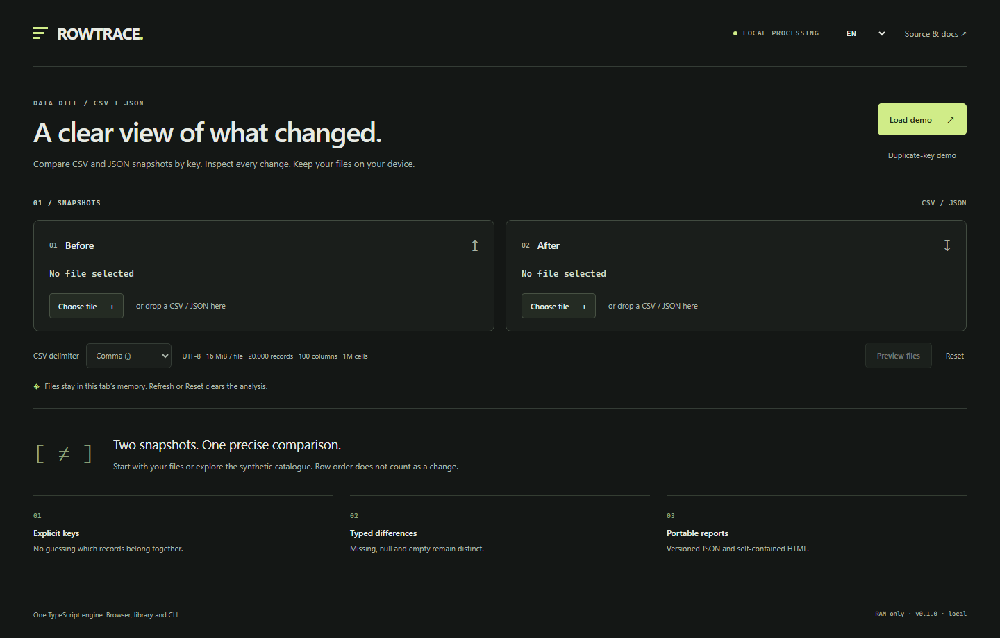
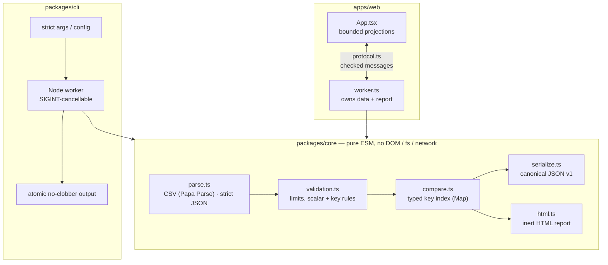

# ROWTRACE

Compare two CSV or flat JSON snapshots by an explicit key, then inspect what changed.

ROWTRACE is a local data review tool with a shared TypeScript engine, browser workbench and command-line interface. Reordering records does not create changes. Duplicate or missing keys block comparison instead of choosing an arbitrary match.

[Live demo](https://seoshiro.github.io/rowtrace/) · [Download packages](https://github.com/seoshiro/rowtrace/releases/tag/v0.1.0) · [CI](https://github.com/seoshiro/rowtrace/actions/workflows/ci.yml)

Version **0.1.0** provides independently installable core and CLI tarballs. The npm packages are **not published**. See the [release record](docs/RELEASE.md) for exact source/CI identity, live checks and remaining validation boundaries.



## Run locally

Use Node 24 and npm. From a clean checkout:

```sh
npm ci
npm run build
npm run preview
```

Open the loopback URL printed by Vite with `/rowtrace/`. The **Load demo** action uses synthetic catalogue snapshots: A17 changes price from 14900 to 16900, B04 is removed, C09 is added and U03 is unchanged. Counts come from the engine.

## Use the package

The initial version is `0.1.0`; report schema version is separately `"1"`. ESM only. Install the verified core tarball from the release, then:

```ts
import { parseDataset, compareDatasets, serializeReport } from '@seoshiro/rowtrace-core';

const before = parseDataset('sku,price\nA17,14900\n', { format: 'csv' });
const after = parseDataset('sku,price\nA17,16900\n', { format: 'csv' });
const report = compareDatasets(before, after, { keyColumns: ['sku'] });
console.log(serializeReport(report));
```

No React, DOM, filesystem, networking or telemetry is required by core. CSV parsing uses Papa Parse and strict JSON token traversal uses Microsoft's jsonc-parser. The independent [consumer example](examples/consumer) compiles declarations and runs the installed public API.

## CLI

Install both release tarballs together into a separate project:

```sh
npm install /path/to/seoshiro-rowtrace-core-0.1.0.tgz /path/to/seoshiro-rowtrace-cli-0.1.0.tgz
npx --no rowtrace before.csv after.csv --key sku --format json
npx --no rowtrace before.csv after.csv --key sku --fail-on-change
npx --no rowtrace before.csv after.csv --key sku --format html --output report.html
```

Exit codes: `0` completed, `1` changes under `--fail-on-change`, `2` invalid input/configuration/I/O, `130` handled interruption. JSON stdout contains only JSON; diagnostics use stderr. Existing reports require `--force`; input files cannot be overwritten even with that flag. See the [CLI documentation](packages/cli/README.md) for composite keys, configuration and platform limits.

## Formats and boundaries

- UTF-8 CSV with a header, optional BOM, comma or explicitly selected semicolon; quoted commas, quotes and multiline fields are supported. CSV values remain strings.
- JSON array of flat objects containing strings, numbers, booleans or null. Missing, null and empty string differ. Duplicate property names, nested values and unsafe integers are rejected. Use strings for exact decimal values and large identifiers.
- Explicit unique or composite keys. No fuzzy matching. Exact comparison is default; explicit normalization/ignored columns are recorded in reports.
- Supported hard ceilings: 16 MiB per input, 20,000 records, 100 columns, 1,000,000 logical cells, 64 KiB UTF-8 per string, 1 KiB per header, 4 KiB encoded key, 16 KiB config and 32 MiB report. These limits combine; they are not a memory guarantee. See [measured conditions and memory use](docs/PERFORMANCE.md).
- XLSX, archives, SQL, PDF, URL inputs and CSV report export are outside this release.

## Privacy and security

Selected browser files stay in memory and are processed in a worker. They are not uploaded, stored in the URL or persisted in browser storage. Exported reports can contain all input values: share them deliberately. The hosting provider still sees normal requests for public app assets and the visitor's IP.

Downloaded HTML reports work offline. The app has no offline shell: starting or restarting a worker may need its static assets, so a fresh analysis after losing connectivity is not guaranteed.

Reports are canonical JSON or self-contained inert HTML. No accounts, backend, database, paid API, billing integration or analytics are part of the product. These choices reduce exposure; they do not guarantee that every possible vulnerability or account risk is eliminated.

## Verify

```sh
npm run lint
npm run build
npm run typecheck
npm test
npm run test:packed
npx playwright install chromium firefox webkit
npm run test:e2e
npm run scan:secrets
```

`test:packed` installs both tarballs and a compiler in a temporary directory outside this repository. Browser tests exercise production output.

## Architecture

One comparison engine, two front ends. The browser app and the CLI call exactly the same parser, comparator and serializers, so a report produced in the browser and one produced in CI are byte-identical for the same input.



### Key decisions

**ADR-1. Shared core package instead of separate browser and CLI logic.** Comparison semantics (typed composite keys, missing vs null vs empty, deterministic ordering) are the product. Keeping them in one framework-free package removes drift between surfaces and lets `test:packed` verify the real installed tarballs. Trade-off: core must avoid Node and DOM APIs entirely, so file reading and downloads live in each front end.

**ADR-2. Heavy data lives in a worker, React holds only projections.** Source text, indexes and full reports stay inside the worker; the UI receives a summary, a 50-row page or one record. Cancelling a job terminates the worker, because a synchronous parser cannot receive a cooperative cancel message. Trade-off: every interaction is a message round trip, guarded by job generations and request counters against stale responses.

**ADR-3. Explicit keys and hard limits instead of fuzzy matching.** Duplicate or missing keys block the comparison rather than picking an arbitrary match, and inputs above 16 MiB / 20,000 rows / 1,000,000 cells are rejected with a clear error. Trade-off: some real-world files need cleaning first, but a reported change is always attributable to a specific key.

## Engineering notes

- [Semantics](docs/SEMANTICS.md): types, identity, errors and deterministic ordering.
- [Architecture](docs/ARCHITECTURE.md): package boundaries, worker ownership and tradeoffs.
- [Security](docs/SECURITY.md): threats, mitigations and limitations.
- [Performance](docs/PERFORMANCE.md): measured timing, memory and bundle sizes.
- [Release](docs/RELEASE.md): exact artifacts, deployment and rollback.

Built with Codex assistance and open-source dependencies. MIT licensed; [upstream notices](apps/web/public/THIRD_PARTY_LICENSES.txt) are also included in the static distribution. No adoption, certification or field-performance claim is made.
